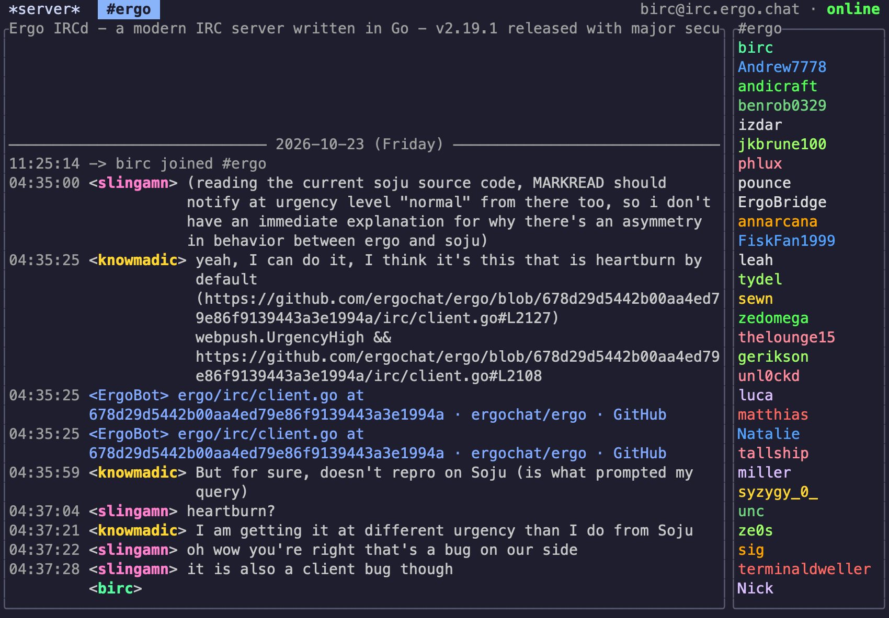

# birc

IRC in the terminal. Channels and queries sit in tabs, a server with IRCv3
history can fill the scrollback, and pictures and files show up in the
conversation.



Connected as `birc` to irc.ergo.chat `#ergo`. The 04:35 lines are that channel's IRCv3
chat history, fetched with `/history latest` after the 11:25 join.

birc is a [Bend 2](https://github.com/bendlang/bend) program with a small C
layer and [timui.h](https://timui.dev). [HACKING.md](HACKING.md) is how to build
it and how the code is put together.

---

## Try it

```sh
# Offline demo, no network
nix run github:zw3rk/birc -- --demo

# The network in the screenshot, with your nick
nix run github:zw3rk/birc -- --connect irc.ergo.chat --nick yournick --channel '#ergo'
```

Once `#ergo` is open, `/history latest #ergo` asks the server for recent lines. The server has to have
negotiated IRCv3 `draft/chathistory`. ergo.chat does. Otherwise birc reports that server history
is unavailable.

Verified TLS on port 6697 is the default. `--plain` selects plaintext and port
6667. `--tls` and `--plain` together are an error. A port never selects the
transport, so `--port 6667` is still TLS unless `--plain` is set. IPv6 is not supported. A
failed TLS handshake stays failed.

From a checkout, the same flags work on `./build/birc`, and `make run HOST=irc.ergo.chat CHAN='#ergo'` connects after a build. The
build steps are in [HACKING.md](HACKING.md).

---

## What you get

- **Tabs** for the server, each channel, and each query. Activity is reverse
  video. Mentions and private messages are gold, and they can ring the terminal
  bell once.
- **A second pane.** `/split` and `/vsplit` watch another buffer you already have open.
- **Scrollback** with day separators. Wheel, Page Up, and Page Down move through
  it. Live `server-time` tags become your local time, including the right daylight-saving
  offset for that date.
- **Server history** on networks that offer it. `/history latest #channel` is what filled the
  screenshot.
- **Your own log.** Recent channels for that hostname and port come back from
  `~/.birc_history.log` the next time you connect.
- **Mouse.** Click a tab, drag to copy, click an `http` or `https` link to open it.
- **Typing indicators** when the server supports IRCv3 `+typing`.
- **Formatting** in messages: `*bold*` or `**bold**`, `_italic_`, and `` `code` ``. Emoji aliases such as
  `:eyes:` are display-only. What you send, and what is stored, stays as you typed
  it.
- **Image previews** for picture links, including animation on Kitty and iTerm2.
  Ordinary `https` page links can grow a short text card underneath.
- **Uploads you confirm.** Drop a file or `/upload` it. Each file waits for its own
  F8. The bytes go to public `0x0.st`.
- **Keychain sign-in** on macOS. The profile file holds the account and the
  channels. The password stays in Keychain.
- **Reconnect.** An unexpected drop retries the same host and port, then rejoins
  the channels you still wanted.

---

## Keys

| Key | Action |
|---|---|
| <kbd>Shift</kbd> + <kbd>&larr;</kbd> | Switch to the previous buffer tab |
| <kbd>Shift</kbd> + <kbd>&rarr;</kbd> | Switch to the next buffer tab |
| <kbd>Page Up</kbd> | Scroll the active buffer up |
| <kbd>Page Down</kbd> | Scroll the active buffer down |
| <kbd>F6</kbd> / <kbd>Ctrl</kbd> + <kbd>W</kbd> | Move focus to the other split pane |
| <kbd>&uarr;</kbd> | Recall the previous command from history |
| <kbd>&darr;</kbd> | Recall the next command from history |
| <kbd>Ctrl</kbd> + <kbd>A</kbd> | Move the composer cursor to the start of the line |
| <kbd>Ctrl</kbd> + <kbd>K</kbd> | Delete from the composer cursor to the end of the line |
| <kbd>Enter</kbd> | Send the typed message or slash command; snap scroll to the latest row |
| <kbd>F8</kbd> | Confirm the currently staged public file upload |
| <kbd>F9</kbd> | Show the newest ready image fullscreen; press again or <kbd>Esc</kbd> to close |
| <kbd>Esc</kbd> | Close the fullscreen overlay; else cancel a pending or running upload; otherwise disconnect and quit |
| <kbd>F10</kbd> | Disconnect and quit |

Click a tab to switch to it. The wheel scrolls the pane under the pointer.
Dragging in a pane copies that pane's text.

---

## Commands

Display formatting supports `*bold*`, `**bold**`, nested bold and italic, `_italic_`, and opaque
dim backticks. Unmatched markers stay literal. A backslash escapes `*`, `_`,
backticks, backslash, or colon. The 22 chat-demo emoji aliases (for example `:eyes:`,
`:fire:`, and `:+1:`) expand only in displayed text. Unknown names, code spans, and
exact URLs stay unchanged. Sent text and history keep the original message.
Styled URLs close formatting at the token end; internal URL punctuation is not
markup. URLs inside styles or code remain display text, not clickable links or
automatic preview requests. Native output and selection preserve combining marks
and emoji sequences. Wrapping prefers spaces between words, including across
formatting runs. Oversized words and URLs still hard-wrap at complete cluster
boundaries. Spaces hidden at a row boundary remain part of scroll and resize
anchors. A cluster that crosses a style boundary uses its leading character's
style. Hanging indents measure the complete painted nickname prefix, including
any cluster that crosses its punctuation. OSC8 hyperlinks keep exact targets
through 1024 bytes; larger targets are declined instead of shortened. Visible
glyphs still depend on terminal fonts.

| Command | Description |
|---|---|
| `/connect <host[:port]> [port]` | Connect using the launch transport; an omitted port reuses the current port |
| `/reconnect` | Reconnect to the saved server and port |
| `/join <channel[,channel…]> [key[,key…]]` | Join channels; retain at most 14 desired channels for recovery |
| `/part [channel]` | Leave the named channel, or the active channel if omitted |
| `/close [buffer]` | Close a query or local tab, or leave a channel; the server buffer cannot close |
| `/msg <target> <text>` | Send a private message to a nick or channel |
| `/notice <target> <text>` | Send a notice without a reply request |
| `/whois [server] <nick[,nick…]>` | Request user information |
| `/who [mask] [flags]` | Request matching users; defaults to the active channel |
| `/list [channels] [server]` | Request channel listings |
| `/names [channels] [server]` | Request nicknames; defaults to the active channel |
| `/topic [channel] [text]` | Query or set a channel topic; `:` clears it |
| `/mode [target] [modes] [args]` | Query or change modes; defaults to the active target |
| `/kick [channel] <nick> [reason]` | Remove a user from a channel |
| `/invite <nick> [channel]` | Invite a user; defaults to the active channel |
| `/away [text]` | Set an away message; omitted text clears it |
| `/raw <command>` / `/quote <command>` | Send one validated IRC command; no prefix or tags |
| `/search <query>` | Search all buffer scrollback and open the results in `*search*` |
| `/history latest <target> [limit]` | Server history when `draft/chathistory` was negotiated |
| `/history before\|after\|around <target> <anchor> [limit]` | Page server history from a message id or timestamp |
| `/history between <target> <a> <b> [limit]` | Server history between two anchors |
| `/history search <text>` | Search the local history file |
| `/history page <offset> <text>` | Continue a local history search |
| `/log` | Open the read-only diagnostic buffer; also works offline |
| `/links` | List links from the focused buffer |
| `/open [n-or-url]` | Open a numbered link or HTTP(S) URL; omitted arguments select the first listed link |
| `/settings` | Open the settings panel |
| `/split [orientation] [buffer]` | Stacked split by default. `horizontal` or `vertical`. The target must already be open |
| `/vsplit [buffer]` | Side-by-side split with an existing buffer |
| `/focus` | Move focus to the other split pane |
| `/split-off` or `/unsplit` | Close the split. Both buffers stay open |
| `/preview <path-or-url>` | Preview a local image, a `file://` path, or an HTTP(S) image URL in `*preview*` |
| `/images on` / `/images off` | Automatic image previews. Explicit `/preview` still works |
| `/upload <local-path> [more-paths]` | Stage local files. Quote paths that contain spaces. F8 confirms each one |
| `/set bell on` / `/set bell off` | Terminal bell for mentions and private messages |
| `/nick <newnick>` | Change your nickname |
| `/me <action>` | CTCP ACTION, for example `/me waves` |
| `/quit [reason]` | Disconnect and exit |

A history limit is 1–100. Leaving it out asks for 50 lines. Without `draft/chathistory`, birc
reports `server history unavailable (draft/chathistory not negotiated)`. `/history search` reads the history file. `/search` reads buffers that are already
open. When history is disabled, local search reports `disk history is disabled`.

Send, scroll, nick-list, and status actions use the focused pane. Split commands
never join a channel or create a buffer. Use `/split *server*` to select the control buffer
explicitly. `/split server` selects a private query named `server` if it exists; otherwise it
keeps the legacy control-buffer alias.

Live connections automatically reconnect to the saved host and port two seconds
after an unexpected disconnect. `/connect` is refused while connecting or waiting for
an automatic retry. Use `/set autoreconn off` to disable this behavior.

Recovery remembers the desired channel set, not only the launch channel.
Accepted `/join` adds intent; PART, closing a channel, and a self-KICK remove it.
The desired set holds at most 14 channels; an overflowing JOIN is rejected
without a partial send or state change. An offline PART can cancel a future
rejoin without sending a wire command. JOIN keys stay in memory for that
endpoint and do not enter history or saved preferences. A new endpoint clears
runtime keys and credentials. Its saved channel names can then supply fresh
autojoin intent. Host spelling and port are part of the saved endpoint identity.
On each connection birc starts authentication again. With configured
credentials, it waits for welcome and verified SASL or NickServ success before
joining. A rejected or untrusted authentication notice cannot release JOIN. The
first valid server welcome establishes the assigned nickname, even if it differs
from the requested nickname. Authentication and room recovery use that identity.
A later conflicting welcome or a peer-forged welcome cannot change it.

Ordinary messages, `/msg`, `/query`, `/notice`, and `/me` split into complete IRC lines when
needed. Splits preserve text and common Unicode clusters. Every action chunk has
its own complete CTCP ACTION envelope. A cluster that cannot fit rejects the
entire message. Credential commands are never split or truncated. `/raw` and `/quote`
reject line injection, enforce the 510-byte payload and 15-parameter limits, and
never enter composer history. Channel key MODE arguments are hidden in chat and
disk history. Ordinary message text is not globally redacted. Until complete
server mode metadata is available, a key-bearing MODE row hides all arguments
rather than guessing which one is the key.

Live server-time tags are UTC event times. birc converts their complete date and
time into your local timezone, including date-specific daylight saving time.
Invalid tags use local receipt time. Untagged messages use receipt time.
Previously saved history contains only `HH:MM:SS`, without a date or timezone; it
cannot be safely converted retroactively.

Runtime preferences changed by `/set` or `/toggle`, scoped mutes, and `/images on|off` use a separate
private, versioned preferences file: `$XDG_CONFIG_HOME/birc/preferences.toml`, or `~/.config/birc/preferences.toml`. Set `BIRC_PREFERENCES` to another path, or
`none` to disable preference IO. The file contains UI settings and per-endpoint
channel names, not passwords or JOIN keys. The Keychain launcher still reads
auth profiles from `config.toml` and passwords from Keychain; chat history uses its own
file.

Interactive preference loading runs after the first paint. Explicit settings
edits made during loading win over stored values. Explicit `--channel`, `BIRC_IMAGES`, and `BIRC_HISTORY_LINES`
take precedence. New files use `0600`; malformed, unknown-version, symlinked,
foreign-owned, or unsafe writable files are not overwritten. Failures use
numeric diagnostics in `*log*`.

On live startup, settings resolve before history loads and the first connection
starts. Local input and quit remain available while the helper or history worker
runs. A failed settings read does not restore or write history under an unknown
policy; an explicit `/set history on` can enable it. Headless startup resolves the same policy
before registration. `BIRC_PREFERENCES=none` keeps the direct startup path. Later endpoint reads
load channel names, not stale global settings. History file IO has no hard
cancellation guarantee on remote file systems. Restored targets get a `Reconnected:`
divider when a row is available. A full buffer keeps its retained rows instead
of removing one for the divider.

One helper owns at most 16 distinct endpoint scopes, including its active job.
Normal quit waits up to 22 seconds for pending saves. If requested changes
cannot be saved, birc restores the terminal and exits nonzero with a fixed
warning.

---

## Launch options

`birc --help-irc` prints these. Bend's own runtime flags (`--help`, `--threads`, `--gpu`) go between `+RTS` and
`-RTS`.

| Option | Argument | Description |
|---|---|---|
| `--connect` | `<host[:port]>` | IRC server hostname or IPv4 address, with optional port |
| `--port` | `<port>` | Server port (1–65535); does not change transport mode |
| `--tls` | — | Verified TLS (default); default port 6697 |
| `--plain` | — | Explicit plaintext; default port 6667; conflicts with `--tls` |
| `--nick` | `<nick>` | IRC nickname (default: `birc`) |
| `--channel` | `<channel[,channel…]>` | Initial channels (default: `#birc`); an empty argument joins none |
| `--demo` | — | Offline demo with canned mock activity |
| `--replay` | `<file>` | Feed an IRC log capture into the client and launch the UI |
| `--frames` | `<n>` | Run for `n` frames (headless batch when stdin is not a tty) |
| `--sasl-user` | `<account>` | Authentication account; defaults to `BIRC_SASL_USER` |
| `--sasl-pass` | `<password>` | Legacy secret flag. Prefer the Keychain wrapper |
| `--auth` | `sasl`, `nickserv`, `sasl-nickserv` | SASL by default; explicit NickServ, or NickServ only when SASL is unavailable |
| `--nickserv-prefix` | `nick!user@host` | Exact trusted service identity; no wildcard masks |
| `--nickserv-success` | `<text>` | Exact successful NOTICE text after IRC formatting controls are removed |
| `--help-irc` | — | Show these options |

An explicit `--nick` always wins, including `me` and `birc`. Without `--nick`, the SASL
username supplies the nickname when configured; otherwise it is `birc`. This
default is resolved after CLI and environment SASL settings are combined.

`--connect HOST:PORT` and `/connect HOST[:PORT] [PORT]` accept DNS names or IPv4 addresses. An additional port may match the
inline port; conflicting values are rejected in either order. The selected
transport persists across later connections. `/connect HOST` reuses the current port,
including a custom port. `/reconnect` reuses the saved host and port. With Make, `TRANSPORT=plain`
selects plaintext and `PORT` is optional.

TLS uses the Nix-provisioned CA bundle and verifies the hostname or IPv4
address. DNS names also use SNI. For a private CA, set `SSL_CERT_FILE` to its trusted PEM
bundle. This changes trust, not verification: there is no
certificate-verification bypass flag. Explicit CA files use bounded regular-file
snapshots. TLS handshake and write waits have deadlines. Access to arbitrary
remote filesystems or CA directories does not have a universal hard-cancellation
guarantee.

### Replay a capture

```sh
./build/birc --replay fixtures/demo.irc
```

Replay is offline. It reads one snapshot of the file through the same framer as
a live connection, keeps a final record that has no newline, and exits nonzero
if the read comes up short. The size bounds are in [HACKING.md](HACKING.md). `fixtures/demo.irc`
is a tiny synthetic capture. `--demo` is the interactive canned session, and it is a
different path.

### Authentication profiles and macOS Keychain

`keychain-birc` keeps passwords in macOS Keychain, not the profile file. Create `~/.config/birc/config.toml` (or
`$XDG_CONFIG_HOME/birc/config.toml`):

```toml
[profiles.work]
host = "irc.example.net"
tls = true
account = "myaccount"
nick = "mynick"
auth = "sasl"
channels = ["#birc", "#work"] # optional names only; never JOIN keys
```

Profiles default to verified TLS and port 6697. `tls = false` explicitly selects plaintext
and defaults to port 6667. An explicit profile port stays unchanged and never
changes transport mode. The profile `host` also accepts `HOST:PORT`; an additional `port` must
agree with it. The wrapper's `--tls` or `--plain` overrides the profile mode; using both
is an error. It resolves the endpoint before looking up the endpoint-bound
Keychain item. An explicit `--channel` overrides profile channels. Without that flag or
a profile list, birc can use the channel names saved for the exact host and
port. An explicitly saved empty list means no automatic JOIN.

TLS profiles need no unsafe flag or local relay. A plaintext profile instead
needs a declared trusted IPv4 loopback relay, or per-launch `--allow-insecure-auth`. For example, an
existing trusted local TLS relay can use `host = "127.0.0.1"`, `port = 16667`, `tls = false`, and `trusted_relay = true`. The wrapper
does not create that relay or verify its TLS configuration. The owned profile
file must be a regular file, not a symlink, and must not allow group or other
users to write it. Password fields are rejected.

```sh
chmod 600 ~/.config/birc/config.toml
nix run github:zw3rk/birc#keychain-birc -- --profile work --channel '#birc'
# For a separate, existing plaintext profile, accept the risk for this launch:
nix run github:zw3rk/birc#keychain-birc -- --profile legacy --allow-insecure-auth
```

The wrapper uses `/usr/bin/security` to find the profile/account password. If none is usable, it
prompts with terminal echo disabled. It saves a newly entered password only
after the client confirms actual authentication on the initial endpoint. Exit
status, welcome messages, and printed text do not count as success. An existing
Keychain item is never overwritten. Denied Keychain access, failed
authentication, or cancelled input does not save it. To replace a saved
password, remove its `birc.auth.v1:` item in Keychain Access and launch the profile again.
The wrapper does not silently update an item. Keychain items use a versioned `birc.auth.v1:`
service name and an encoded `birc-v1:` value to preserve spaces and Unicode. This
encoding is not encryption; Keychain supplies storage protection. The wrapper
does not put its password in child arguments, environment variables, temporary
files, or diagnostic logs. Authentication requests do not enter chat history.
Arbitrary incoming messages are not globally redacted.

To use NickServ, select `auth = "nickserv"`. To prefer SASL and fall back only when SASL is
explicitly unavailable, select `auth = "sasl-nickserv"`. Both require network-specific trusted
metadata, for example:

```toml
nickserv_prefix = "NickServ!service@services.example"
nickserv_success = "You are now identified for myaccount."
```

Replace both values with the service's real identity and successful NOTICE. Use
a trusted network or relay that reserves and controls the service nickname. IRC
messages address nicknames, so the prefix probe does not cryptographically bind
the recipient or protect against a compromised server or nickname takeover. The
client first sends a harmless `HELP` request. Only a NOTICE from that exact full
identity, directed to the current nick, releases the `IDENTIFY` password. Only the
exact configured confirmation then marks authentication successful. NickServ
credentials must fit one IRC line and contain no whitespace; invalid credentials
are not truncated or sent. There is no fallback after a bad SASL password.
Changing host or port clears the loaded credentials for the rest of that client
session, even if you return to the original endpoint. Start the wrapper again to
load another profile.

Direct launches still support `BIRC_SASL_USER` and `BIRC_SASL_PASS`; a nonempty CLI value takes
precedence. They do not persist a password. On a plaintext connection, SASL
PLAIN and NickServ IDENTIFY expose the password. Use native TLS or a trusted TLS
relay unless you accept this risk explicitly. The unsafe flag belongs to the
wrapper, not the core IRC client.

Automatic authentication bypasses the composer. Manual service credential
commands retain their wire text but use a redacted local echo and skip command
history; their own server echoes are also suppressed. Text typed manually in the
composer remains visible. Prefer the wrapper for private password entry.

---

## Stored history

History records use `BIRC2` and include the server hostname and port. Different
hosts or ports do not share stored history. Archive lookup ignores hostname
case; credentials, runtime keys, and preferences use exact host spelling and
port. An endpoint change clears live chat buffers. The in-memory `*log*` belongs to
the app session and survives endpoint changes. The reader scans the file to its
initial size, keeps only the configured recent records, and rejects malformed or
overlong records. An incomplete final record is not loaded. When historical
conversations exceed the available buffer slots, restore retains the most
recently used targets. Server and local tabs are preserved. A zero history cap
restores no chat targets.

History writes create private `0600` files. An existing regular file owned by the
current user is repaired to `0600` before appending, without changing its contents.
Symlinks, nonregular files, and files owned by another user are not written. A
failed permission check or write is reported in `*log*`.

The default path is `~/.birc_history.log`. `BIRC_HISTORY` selects another file. `none` or an empty value
disables it. `BIRC_HISTORY_LINES` is how many lines each restored target may receive. Unset, that
limit is 100, and only rows that still fit are restored.

The pinned file-size API supports at most 4,294,967,295 bytes. Larger files
produce a visible history error instead of an empty restore. Other size/read
errors are also visible. A failed read retains only completed records from the
prefix already read. A missing optional history file is normal.

Older records without an endpoint remain in the file but are not restored. Their
server identity cannot be recovered safely. Reconnect dividers and `/links` output
are display data and are not saved as chat.

---

## Diagnostic log

Errors stay in their original buffer. A private copy also appears in `*log*`,
without changing focus. `/log` opens the log; `/close` removes it. The next error
creates it again. Connection, reconnect, and authentication stages are recorded
while the log exists.

The log holds at most 128 rows of 512 characters in memory. It survives server
changes, but is not saved to chat history. One of the existing 16 buffer slots
is reserved for it. Diagnostic copies remove HTTP(S) URLs and configured SASL
credentials. Helper failures show only the operation and numeric error or exit
code, never child output. This does not redact the original chat/error row. IRC
events cannot create, rename, or target reserved local buffers such as `*log*`.
Ordinary channels, private queries, and server broadcasts stay separate.

The log includes failed clipboard helpers, link openers, image previews, history
loads/saves, and socket reads. A fatal startup error can exit before there is an
interactive buffer; it remains an exit diagnostic.

---

## Images and privacy

Automatic previews apply to new live messages and visible saved-history messages
with direct PNG, JPEG, GIF, WebP, BMP, TIFF, or AVIF links, or Markdown ``
image links. History uses the same bounded asynchronous preview worker as live
messages. Changing tabs or scrolling admits older visible images; startup does
not fetch every archived link. Replay and demo messages do not trigger automatic
requests. Sent messages and stored history keep the exact original text and URL.

Fetching an image discloses your IP address to its host. Use `/images off` or start with
`BIRC_IMAGES=off` to prevent automatic requests. Disabling previews clears their visible state
and ignores late automatic results. A helper already running finishes within its
bound; disabling or quitting does not cancel it.

The helper permits only public HTTP(S) hosts on standard ports. It checks every
redirect, pins resolved addresses for connection, verifies HTTPS certificates,
and sends no cookies or proxy credentials. It does not fetch private/loopback
hosts, follow HTTPS-to-HTTP redirects, or load local paths posted in chat.
Explicit local previews require a bounded regular file. Local and remote
previews both require helper acceptance and normalization; pending or rejected
input is never uploaded through a raw-file fallback.

Downloads are capped at 8 MiB; local inputs at 16 MiB. Source images are capped
at 4096 pixels per side and 16,777,216 pixels. Normalized previews fit within
320 pixels per side. Animations have at most 24 frames, 33,554,432 source-frame
pixels (including an APNG fallback image), and 1,536,000 normalized pixels in
total. The binary envelope is capped at 2 MiB before base64 encoding. The helper
has an eight-second deadline. Bend allows one active helper, eight queued
requests, and eight cached results. A frame can show at most eight image
placements, including repeated uses of the same cached image.

Successfully decoded remote image files are also cached privately in `$XDG_CACHE_HOME/birc/images`, or `~/.cache/birc/images`
when unset. The disk cache keeps at most 64 files and 64 MiB, evicting the
oldest stored files. Atomic writes can use one extra staging file of at most 8
MiB. Its names are URL hashes; it stores no separate URL metadata. Cache hits
are decoded and normalized again without contacting the host. Missing or corrupt
entries are fetched asynchronously. Cache failures do not prevent a valid
preview. Local files are not copied into this cache. The cache directory must be
private and owned by the current user. Symlinks anywhere in its path disable
cache access; ordinary cache IO failures fall back to fetching. Set `BIRC_IMAGE_CACHE=none` to
disable disk caching, or set it to an explicit cache directory. This does not
disable network fetches; use `/images off` to disable automatic previews.

Kitty and iTerm2 handle animation in the terminal; birc does not add an
animation timer. Sixel uses the first frame. If no terminal image protocol is
detected, birc keeps URLs as normal chat text, skips image helpers, and records
one explanation in `*log*` when a preview is requested. This applies to automatic
and explicit previews. It does not change the saved `/images on|off` preference.

Supported terminals can still show `[img]` while loading, after preview rejection,
or for an unsupported crop. A partially clipped iTerm2 image uses that fallback
because its protocol has no source-crop command. Check `/log` for `image preview unavailable` after helper
rejection. Terminal and multiplexer support can differ. Ghostty is recognized as
a Kitty-graphics terminal, but tmux, screen, and zellij disable automatic
image-protocol selection. Detection uses `TERM` and `TERM_PROGRAM`, not the window's
appearance. If a Ghostty shell reports `TERM=xterm-256color` and `TERM_PROGRAM=Apple_Terminal`, birc selects no image
protocol. Declare Ghostty's protocol for that launch:

```sh
TIMUI_IMAGE_PROTOCOL=kitty nix run github:zw3rk/birc -- --connect irc.libera.chat:6697 --nick YOUR_NICK
```

Use this override only in a terminal that supports Kitty graphics. It does not
enable multiplexer passthrough. Correcting the shell's terminal identity also
restores automatic detection; do not set Ghostty's identity in Apple Terminal.

### Link cards and fullscreen images

Visible `https://` page links (never images, plaintext, code, or styled fragments) also
fetch bounded OpenGraph text cards through one cards worker. Ready cards paint
up to four dim text rows under their chat line; chat history keeps the exact
original text. Fetching a card discloses your IP address to its host. Start with
`BIRC_CARDS=off` to prevent automatic requests; disabling keeps a running worker until its
exact completion but stores nothing new. Reconnecting to the same host and port
keeps text cards; connecting elsewhere drops them and closes the overlay.

Press F9 to show the newest ready image fullscreen, and F9 or Esc to close it.
The overlay re-checks its image token, source, and terminal support on every
paint, so it closes itself when the image is gone.

---

## Public file uploads

Focus an online channel or query. Drop exact absolute paths or local `file:///` URLs
into the composer, then press Enter. You can also use:

```text
/upload '/path/to/image.jpg' './another file.txt'
```

Quotes and backslashes decode literal paths. They do not run a shell or expand
variables, globs, or `~`. Up to eight files can be staged together. Bare `/name` is
treated as a slash command, not an implicit root-level file drop. Use `/upload /name` or
quote the path to remove that ambiguity. Images and other regular files are
supported, through 32 MiB per file. Empty files, final symlinks, and nonregular
files are refused.

The status row identifies the public destination, target, and next basename.
Press F8 to authorize that file. Each remaining file needs another F8. Enter or
pasted confirmation text cannot authorize an upload. Ordinary draft editing,
completion, history, and navigation remain available while the helper runs.
Upload commands and dropped paths do not enter command history or chat. A
successful URL is sent as ordinary IRC text and can be saved in chat history. An
overlong URL is refused, never shortened.

This sends file contents to public storage. 0x0.st also receives your IP address
and user agent. The helper requests a harder-to-guess URL, not encryption or
access control. Do not upload a file that must remain private. The remote
filename is generic; the file contents can still identify you.

Esc cancels pending consent and queued files. If text is selected, the first Esc
clears the selection; press Esc again to cancel the upload. For an upload
already running, it prevents the resulting URL from being sent; it cannot
retract bytes already sent to storage. Changing the connection or focused target
also invalidates that result, even if you later return. Cancelling or quitting
does not kill the running helper. It has a 30-second wall-clock bound; Bend's
helper call has a separate 35-second bound. Only one upload helper runs at a
time.

Upload code 5 means an HTTP rejection or an invalid service reply. A verified
numeric HTTP status appears in `*log*` when available. Response bodies, private
paths, and arbitrary helper diagnostics stay hidden.

Development overrides for the image, card, upload, and preference helpers are in
[HACKING.md](HACKING.md).

---

## Building

[HACKING.md](HACKING.md) covers the Nix shell, `make check`, the module map, and the
proofs.

---

## License

Licensed under the **Apache License, Version 2.0** ([`LICENSE`](LICENSE)).

Copyright (c) Moritz Angermann <moritz@zw3rk.com>, zw3rk pte. ltd.
